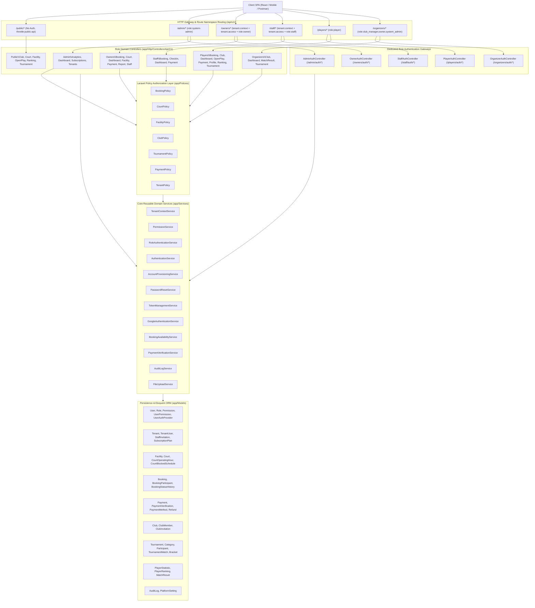

# CourtFlex — Backend Architecture & Route Namespacing

## Overview
CourtFlex is designed as a centralized, shared-schema multi-tenant REST API platform built on **Laravel 13** and **PHP 8.5**. The architecture emphasizes strict role boundaries, thread-safe tenant context resolution, granular authorization policies, and clean separation between HTTP controllers, domain services, and database persistence.

---

## High-Level Architecture Diagram

---

## Architectural Layers

### 1. Presentation & Routing Layer (`routes/api/v1/`)
- **Strict Role Partitioning**: Every primary role (`admin`, `owners`, `staff`, `players`, `organizers`) has a distinct URL namespace with dedicated route definitions, middleware stacks, and role auth controllers.
- **No Shared Player Auth Routes**: Player authentication resides cleanly under `/api/v1/players/auth/*`.
- **Public Discovery**: Unauthenticated exploration of venues, courts, and rankings is isolated under `/api/v1/public/*`.
- **Web Layer**: The root web route `GET /` explicitly returns `404 Not Found`. An interactive API catalog is available at `GET /docs-api-endpoints`.

### 2. Security, Rate Limiting & Middleware Layer
- **`throttle:*`**: Named rate limiters protecting against brute force and DDoS attacks (`login: 5/min`, `register: 5/min`, `sensitive: 10/min`, `api: 120/min`, `public-api: 60/min`).
- **`auth:sanctum`**: Validates stateless Bearer tokens issued via Laravel Sanctum.
- **`account.active`**: Checks that the user's `account_status` is `active` (rejects `suspended` or `pending` accounts with `403 Forbidden`).
- **`tenant.context`**: Resolves the tenant context from `X-Tenant-ID` header, route parameter, or user tenancy.
- **`tenant.access`**: Validates that the authenticated user belongs to the active tenant.
- **`role:*`**: Verifies that the user has the required operational role in tenant scope or platform scope.

### 3. Request Validation Layer (`app/Http/Requests/`)
All mutating endpoints use dedicated Form Request classes:
- **Input Sanitization**: Strong typing, string lengths, MIME types, file size bounds, date ranges, and regex patterns.
- **Business Rule Validation**: Unique constraints, foreign key validation, password strength rules (`Password::min(8)->letters()->numbers()`).
- **Standard Error Format**: Validation failures automatically produce `422 Unprocessable Content` with `{ success: false, message: "...", errors: { ... } }`.

### 4. Policy & Authorization Layer (`app/Policies/`)
Resource mutations and sensitive reads are guarded by Laravel Policies:
- [`BookingPolicy`](file:///C:/Users/ec.40021031/Documents/edscodes/myprojects/pickleball-booking-app/app/Policies/BookingPolicy.php): Restricts cancellation, viewing, and updates to the booking owner, assigned facility staff, or venue owner.
- [`FacilityPolicy`](file:///C:/Users/ec.40021031/Documents/edscodes/myprojects/pickleball-booking-app/app/Policies/FacilityPolicy.php): Restricts venue modifications to facility owners and platform admins within the active tenant context.
- [`TournamentPolicy`](file:///C:/Users/ec.40021031/Documents/edscodes/myprojects/pickleball-booking-app/app/Policies/TournamentPolicy.php): Ensures only authorized club managers or owners can update brackets or record match scores.
- [`PaymentPolicy`](file:///C:/Users/ec.40021031/Documents/edscodes/myprojects/pickleball-booking-app/app/Policies/PaymentPolicy.php): Restricts payment verification to staff and owners.

### 5. Domain Services Layer (`app/Services/`)
Business logic is decoupled from controllers and encapsulated in reusable, testable services:
- **`AuthenticationService`**: Verifies credentials, executes audit logging, evaluates role permissions, and constructs standardized auth response envelopes.
- **`RoleAuthenticationService`**: Assesses whether a user is eligible to log into a requested role portal.
- **`AccountProvisioningService`**: Atomically provisions global players, owner tenants, and processes invitations.
- **`PasswordResetService`**: Generates cryptographic reset tokens and safely resets passwords across all devices.
- **`TokenManagementService`**: Issues Sanctum tokens and safely revokes active device sessions.
- **`TenantContextService`**: Thread-safe active tenant resolution.
- **`BookingAvailabilityService`**: Real-time slot availability, double-booking prevention, operating hour validation, and blocked schedules.
- **`PaymentVerificationService`**: State machine for approving or rejecting manual payment receipts.
- **`FileUploadService`**: Uploads private and public assets with MIME type verification and SHA-256 storage naming.

### 6. Standardized Response & Resource Layer (`app/Http/Resources/`)
- API endpoints transform Eloquent models into JSON using dedicated API Resources (`UserResource`, `ClubResource`, `TournamentResource`, `TournamentMatchResource`, `OpenPlaySessionResource`, `SubscriptionPlanResource`, `AuditLogResource`).
- Strictly hides sensitive internal attributes (`password`, `mfa_secret`, `remember_token`).
- Implements eager loading (`with()`) to eliminate N+1 database queries.
