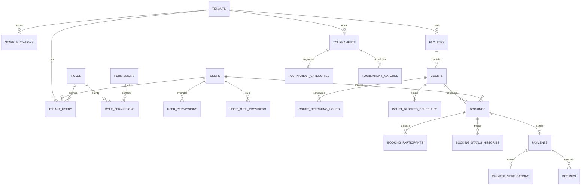

# CourtFlex — Database Schema & Data Dictionary

The CourtFlex database is structured into 10 cohesive relational domains designed for MySQL in production and fully SQLite-compatible for local development and CI testing.

---

## Entity Relationship Overview

---

## Domain Tables

### 1. Platform & Authentication
- `users`:
  - `id`: unsigned bigint PK
  - `name`: varchar(255)
  - `email`: varchar(255) UNIQUE
  - `phone`: varchar(25) NULL, INDEX
  - `password`: varchar(255)
  - `avatar`: varchar(500) NULL
  - `account_status`: varchar(50) DEFAULT 'active', INDEX (`active`, `suspended`, `pending`)
  - `mfa_enabled`: boolean DEFAULT false
  - `mfa_secret`: varchar(255) NULL
  - `email_verified_at`: timestamp NULL
  - `timestamps`
- `user_auth_providers`:
  - `id`: unsigned bigint PK
  - `user_id`: FK -> users(id) ON DELETE CASCADE
  - `provider`: varchar(50) (`google`, `apple`)
  - `provider_user_id`: varchar(255)
  - `provider_email`: varchar(255) NULL
  - `avatar`: varchar(500) NULL
  - `timestamps`
  - UNIQUE KEY (`provider`, `provider_user_id`)
- `tenants`:
  - `id`: unsigned bigint PK
  - `name`: varchar(255)
  - `slug`: varchar(255) UNIQUE
  - `business_email`: varchar(255)
  - `business_phone`: varchar(30) NULL
  - `address`: varchar(255) NULL
  - `logo`: varchar(500) NULL
  - `status`: varchar(50) DEFAULT 'active', INDEX (`active`, `suspended`, `trial`)
  - `subscription_plan_id`: unsigned bigint NULL, INDEX
  - `timestamps`
- `roles`:
  - `id`: unsigned bigint PK
  - `name`: varchar(100) UNIQUE (`system_admin`, `owner`, `staff`, `player`, `club_manager`)
  - `label`: varchar(255)
  - `scope`: varchar(50) DEFAULT 'tenant' (`platform`, `tenant`)
  - `description`: text NULL
  - `timestamps`
- `permissions`:
  - `id`: unsigned bigint PK
  - `name`: varchar(100) UNIQUE
  - `label`: varchar(255)
  - `group`: varchar(100) INDEX
  - `description`: text NULL
  - `timestamps`
- `role_permissions`:
  - `role_id`: FK -> roles(id) ON DELETE CASCADE
  - `permission_id`: FK -> permissions(id) ON DELETE CASCADE
  - PRIMARY KEY (`role_id`, `permission_id`)
- `tenant_users`:
  - `id`: unsigned bigint PK
  - `tenant_id`: FK -> tenants(id) ON DELETE CASCADE
  - `user_id`: FK -> users(id) ON DELETE CASCADE
  - `role_id`: FK -> roles(id) ON DELETE CASCADE
  - `status`: varchar(50) DEFAULT 'active' (`active`, `inactive`, `invited`)
  - UNIQUE KEY (`tenant_id`, `user_id`)
  - `timestamps`
- `staff_invitations`:
  - `id`: unsigned bigint PK
  - `tenant_id`: FK -> tenants(id) ON DELETE CASCADE
  - `email`: varchar(255) INDEX
  - `role_id`: FK -> roles(id) ON DELETE CASCADE
  - `invited_by`: FK -> users(id) ON DELETE CASCADE
  - `token`: varchar(64) UNIQUE
  - `status`: varchar(50) DEFAULT 'pending' (`pending`, `accepted`, `expired`, `revoked`)
  - `expires_at`: timestamp
  - `timestamps`
- `user_permissions`:
  - `id`: unsigned bigint PK
  - `user_id`: FK -> users(id) ON DELETE CASCADE
  - `permission_id`: FK -> permissions(id) ON DELETE CASCADE
  - `tenant_id`: FK -> tenants(id) NULL ON DELETE CASCADE
  - `is_revoked`: boolean DEFAULT false
  - `timestamps`
- `password_reset_tokens`:
  - `email`: varchar(255) PK
  - `token`: varchar(255)
  - `created_at`: timestamp NULL
- `personal_access_tokens`: Sanctum bearer tokens.

### 2. SaaS Management
- `subscription_plans`:
  - `id`, `name`, `slug` (UNIQUE), `description`, `price` (decimal 10,2), `billing_interval`, `max_courts`, `max_staff`, `features` (JSON), `is_active`, `timestamps`.
- `tenant_subscriptions`:
  - `id`, `tenant_id` (FK), `subscription_plan_id` (FK), `status`, `starts_at`, `ends_at`, `trial_ends_at`, `timestamps`.
- `subscription_invoices`:
  - `id`, `tenant_id` (FK), `tenant_subscription_id` (FK), `invoice_number` (UNIQUE), `amount` (decimal 10,2), `status`, `paid_at`, `timestamps`.
- `platform_settings`:
  - `id`, `key` (UNIQUE), `value`, `type`, `is_public`, `timestamps`.

### 3. Facility & Court Management
- `facilities`:
  - `id`, `tenant_id` (FK), `name`, `slug`, `description`, `phone`, `email`, `address`, `city`, `state`, `postal_code`, `latitude`, `longitude`, `is_active`, `timestamps`.
  - UNIQUE KEY (`tenant_id`, `slug`).
- `courts`:
  - `id`, `facility_id` (FK), `tenant_id` (FK), `name`, `court_type`, `surface_type`, `hourly_rate` (decimal 10,2), `is_active`, `timestamps`.
- `court_operating_hours`:
  - `id`, `court_id` (FK), `day_of_week` (0-6), `open_time`, `close_time`, `is_closed`, `timestamps`.
  - UNIQUE KEY (`court_id`, `day_of_week`).
- `court_blocked_schedules`:
  - `id`, `court_id` (FK), `tenant_id` (FK), `starts_at`, `ends_at`, `reason`, `created_by` (FK), `timestamps`.

### 4. Bookings & Reservations
- `bookings`:
  - `id`, `tenant_id` (FK), `court_id` (FK), `user_id` (FK), `booking_reference` (UNIQUE), `starts_at`, `ends_at`, `total_amount` (decimal 10,2), `status` (`pending_payment`, `confirmed`, `checked_in`, `completed`, `cancelled`), `notes`, `timestamps`.
  - INDEX (`court_id`, `starts_at`, `ends_at`).
- `booking_participants`:
  - `id`, `booking_id` (FK), `user_id` (FK NULL), `guest_name`, `guest_email`, `status`, `timestamps`.
- `booking_status_histories`:
  - `id`, `booking_id` (FK), `changed_by` (FK), `from_status`, `to_status`, `reason`, `timestamps`.

### 5. Payments & Financial Verifications
- `payment_methods`: `id`, `user_id` (FK), `type`, `details` (JSON), `is_default`, `timestamps`.
- `payments`: `id`, `tenant_id` (FK), `booking_id` (FK NULL), `user_id` (FK), `amount` (decimal 10,2), `currency`, `payment_method`, `transaction_reference` (UNIQUE), `status` (`pending`, `verified`, `rejected`, `refunded`), `proof_attachment`, `timestamps`.
- `payment_verifications`: `id`, `payment_id` (FK), `verified_by` (FK), `status`, `notes`, `verified_at`, `timestamps`.
- `refunds`: `id`, `payment_id` (FK), `processed_by` (FK), `amount` (decimal 10,2), `reason`, `status`, `timestamps`.

### 6. Clubs
- `clubs`: `id`, `tenant_id` (FK NULL), `creator_id` (FK), `name`, `slug` (UNIQUE), `description`, `logo`, `privacy`, `max_members`, `timestamps`.
- `club_members`: `id`, `club_id` (FK), `user_id` (FK), `role` (`manager`, `organizer`, `member`), `status` (`active`, `pending`, `rejected`), `joined_at`, `timestamps`, UNIQUE (`club_id`, `user_id`).
- `club_invitations`: `id`, `club_id` (FK), `invited_user_id` (FK NULL), `invited_email`, `invited_by` (FK), `token` (UNIQUE), `status`, `expires_at`, `timestamps`.

### 7. Open Play Sessions
- `open_play_sessions`: `id`, `tenant_id` (FK), `court_id` (FK), `title`, `starts_at`, `ends_at`, `max_participants`, `fee` (decimal 10,2), `skill_level_min`, `skill_level_max`, `status`, `timestamps`.
- `open_play_participants`: `id`, `open_play_session_id` (FK), `user_id` (FK), `payment_id` (FK NULL), `check_in_status`, `timestamps`, UNIQUE (`open_play_session_id`, `user_id`).

### 8. Tournaments
- `tournaments`: `id`, `tenant_id` (FK), `organizer_id` (FK), `name`, `slug` (UNIQUE per tenant), `format`, `starts_at`, `ends_at`, `registration_deadline`, `entry_fee`, `max_teams`, `status`, `timestamps`.
- `tournament_categories`: `id`, `tournament_id` (FK), `name`, `division`, `skill_level`, `timestamps`.
- `tournament_participants`: `id`, `tournament_id` (FK), `tournament_category_id` (FK NULL), `user_id` (FK), `partner_id` (FK NULL), `team_name`, `payment_id` (FK NULL), `seed`, `status`, `timestamps`.
- `tournament_matches`: `id`, `tournament_id` (FK), `tournament_category_id` (FK NULL), `court_id` (FK NULL), `round_number`, `match_number`, `participant1_id`, `participant2_id`, `winner_id`, `score`, `status`, `scheduled_at`, `timestamps`.
- `tournament_brackets`: `id`, `tournament_id` (FK), `tournament_category_id` (FK NULL), `bracket_data` (JSON), `timestamps`.

### 9. Rankings & Statistics
- `player_statistics`: `id`, `user_id` (FK UNIQUE), `matches_played`, `matches_won`, `matches_lost`, `tournaments_played`, `tournaments_won`, `current_rating` (decimal 5,2), `timestamps`.
- `player_rankings`: `id`, `user_id` (FK), `category`, `rank`, `points`, `recorded_date`, `timestamps`.
- `match_results`: `id`, `matchable_type`, `matchable_id`, `participant1_id` (FK), `participant2_id` (FK), `winner_id` (FK), `scores` (JSON), `verified_by` (FK), `verified_at`, `timestamps`.

### 10. Audit Logs
- `audit_logs`: `id`, `tenant_id` (FK NULL), `user_id` (FK NULL), `action`, `entity_type`, `entity_id`, `old_values` (JSON), `new_values` (JSON), `ip_address`, `user_agent`, `timestamps`.
