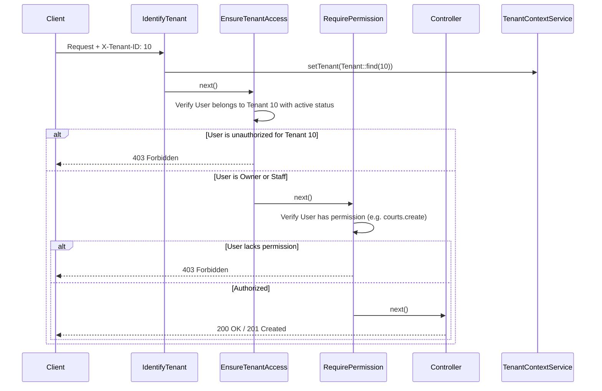

# CourtFlex — Multi-Tenancy Architecture Guide

## Overview
CourtFlex implements a **centralized, single-database, shared-schema multi-tenant architecture**.

This design was chosen specifically for sports booking and management to achieve:
1. **Global Player Network**: Players have one global account and can book courts, join open play sessions, and enter tournaments across all venues without fragmented logins.
2. **Tenant Isolation**: Facility owners and staff are strictly restricted to accessing only their facility's courts, bookings, staff rosters, and financial records.
3. **Operational Simplicity**: One database schema simplifies migrations, centralized backups, and cross-facility analytics.

---

## Tenant Identification & Resolution

The active tenant is resolved on every request via the `IdentifyTenant` middleware.

Resolution Priority:
1. `X-Tenant-ID` HTTP Request Header (ID or slug)
2. `{tenant}` route parameter (e.g. `/api/v1/tenants/{tenant}/...`)
3. `tenant_id` request input query parameter

Once resolved:
```php
app(TenantContextService::class)->setTenant($tenant);
```

---

## Tenant Access & Enforcement Pipeline



---

## Safe Query Scoping (`BelongsToTenant`)

All tenant-scoped Eloquent models use the `App\Models\Traits\BelongsToTenant` trait:
- `tenant()` relationship definition.
- `scopeForTenant($query, $tenantId)` local scope.

Controllers and services explicitly scope operations using:
```php
$tenantId = app(TenantContextService::class)->getTenantId();

$courts = Court::where('tenant_id', $tenantId)->get();
```

---

## Rules to Prevent Cross-Tenant Leakage

1. **Never Trust Client-Submitted Tenant IDs**: The backend always verifies the authenticated user has an active membership record in `tenant_users` matching the targeted `tenant_id`.
2. **System Admin Exception**: Users with the `system_admin` role bypass tenant membership checks to enable platform support and maintenance.
3. **Audit Trails**: Every administrative and financial mutation records the active `tenant_id` and performing `user_id` in `audit_logs`.
