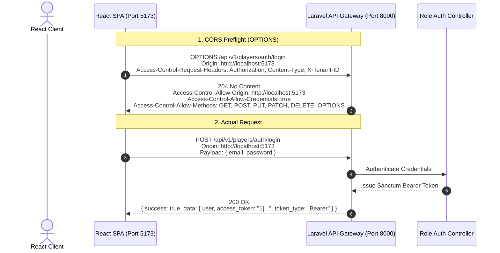

# CourtFlex — React Frontend & Laravel API Integration Guide

This guide details how the **React Frontend (Vite SPA)** communicates securely with the **CourtFlex Laravel 13 REST API Backend** across local development and production environments.

---

## 1. Architecture Overview

CourtFlex uses a decoupled architecture where the React frontend and Laravel backend run on independent origins:

- **Backend**: Laravel REST API (`http://localhost:8000` in dev, `https://api.courtflex.com` in prod)
- **Frontend**: React Single-Page App (`http://localhost:5173` in dev, `https://courtflex.com` in prod)
- **Base API Path**: `/api/v1`
- **Primary Authentication**: Laravel Sanctum Personal Access Tokens (Bearer Token, Option A)
- **Secondary Authentication**: Sanctum Stateful Cookie Sessions (Option B for same-apex domains)
- **Multi-Tenancy**: Scoped via `X-Tenant-ID` header



---

## 2. Environment Configuration

### React Environment (`.env.development` / `.env.production`)
In your React Vite project root:

```env
# .env.development (Local Development)
VITE_API_BASE_URL=http://localhost:8000/api/v1
VITE_GOOGLE_CLIENT_ID=your-google-oauth-client-id.apps.googleusercontent.com

# .env.production (Production)
VITE_API_BASE_URL=https://api.courtflex.com/api/v1
VITE_GOOGLE_CLIENT_ID=your-google-oauth-client-id.apps.googleusercontent.com
```

> [!WARNING]
> Never put backend secrets (such as Google Client Secret, Database Passwords, or App Keys) into React Vite `.env` files. Vite embeds variables starting with `VITE_` into client-side JS bundles.

### Laravel Backend Environment (`.env`)
In the CourtFlex Laravel backend:

```env
APP_URL=http://localhost:8000

# Frontend Allowed Origins (Comma-separated, no trailing slash, no wildcards)
FRONTEND_URL=http://localhost:5173
FRONTEND_ALLOWED_ORIGINS=http://localhost:5173,http://127.0.0.1:5173,http://localhost:3000

# Sanctum Stateful Domains (Used when opting for Cookie Sessions)
SANCTUM_STATEFUL_DOMAINS=localhost:5173,127.0.0.1:5173,localhost:3000,localhost:8000

# CORS Credentials & Max Age (Seconds)
CORS_SUPPORTS_CREDENTIALS=true
CORS_MAX_AGE=86400
```

In production:
```env
APP_URL=https://api.courtflex.com
FRONTEND_URL=https://courtflex.com
FRONTEND_ALLOWED_ORIGINS=https://courtflex.com,https://www.courtflex.com
SANCTUM_STATEFUL_DOMAINS=courtflex.com,www.courtflex.com
CORS_SUPPORTS_CREDENTIALS=true
```

---

## 3. Production-Ready Axios Client (`src/api/client.js`)

Below is the complete, recommended HTTP client for your React application using Axios:

```javascript
import axios from 'axios';

// --------------------------------------------------------------------------
// 1. Secure Token & Tenant Storage Helper
// --------------------------------------------------------------------------
const TOKEN_KEY = 'courtflex_access_token';
const TENANT_KEY = 'courtflex_active_tenant_id';

export const tokenStorage = {
    getToken: () => sessionStorage.getItem(TOKEN_KEY),
    setToken: (token) => sessionStorage.setItem(TOKEN_KEY, token),
    removeToken: () => sessionStorage.removeItem(TOKEN_KEY),
    getTenantId: () => sessionStorage.getItem(TENANT_KEY),
    setTenantId: (tenantId) => sessionStorage.setItem(TENANT_KEY, tenantId),
    removeTenantId: () => sessionStorage.removeItem(TENANT_KEY),
    clear: () => {
        sessionStorage.removeItem(TOKEN_KEY);
        sessionStorage.removeItem(TENANT_KEY);
    },
};

// --------------------------------------------------------------------------
// 2. Axios Instance
// --------------------------------------------------------------------------
const api = axios.create({
    baseURL: import.meta.env.VITE_API_BASE_URL || 'http://localhost:8000/api/v1',
    headers: {
        'Accept': 'application/json',
        'Content-Type': 'application/json',
    },
    // Set to true if supporting cookies or credentials
    withCredentials: true,
});

// --------------------------------------------------------------------------
// 3. Request Interceptor (Inject Token & Multi-Tenant ID)
// --------------------------------------------------------------------------
api.interceptors.request.use(
    (config) => {
        const token = tokenStorage.getToken();
        if (token) {
            config.headers.Authorization = `Bearer ${token}`;
        }

        const tenantId = tokenStorage.getTenantId();
        if (tenantId) {
            config.headers['X-Tenant-ID'] = tenantId;
        }

        return config;
    },
    (error) => Promise.reject(error)
);

// --------------------------------------------------------------------------
// 4. Response Interceptor (Standard Error Formatting & 401 Handling)
// --------------------------------------------------------------------------
api.interceptors.response.use(
    (response) => {
        // Return standard response data envelope directly
        return response.data;
    },
    (error) => {
        const { response } = error;

        // Catch 401 Unauthorized (Expired or Revoked Token)
        if (response && response.status === 401) {
            tokenStorage.clear();
            // Optional: redirect to login if not already on login page
            if (!window.location.pathname.includes('/login')) {
                window.location.href = '/login?expired=1';
            }
        }

        // Standardize CourtFlex API Error payload
        const errorData = response?.data || {
            success: false,
            message: error.message || 'Network error occurred.',
            errors: {},
        };

        return Promise.reject(errorData);
    }
);

export default api;
```

---

## 4. Authentication Strategy

### Option A: Bearer Token Authentication (Recommended for React)
Each login or register response returns:

```json
{
  "success": true,
  "message": "Authentication successful.",
  "data": {
    "user": {
      "id": 1,
      "name": "Jane Doe",
      "email": "jane@example.com",
      "active_role": "player",
      "available_roles": ["player"]
    },
    "access_token": "1|qX129...",
    "token_type": "Bearer",
    "context": null
  }
}
```

Store `access_token` in memory or `sessionStorage` via `tokenStorage.setToken(data.access_token)`.

### Option B: Sanctum Stateful Cookie Authentication
If your React frontend and Laravel backend share the exact same apex domain (e.g. `app.courtflex.com` and `api.courtflex.com`), you can use stateful cookie sessions:

1. In React, request the CSRF cookie before making login requests:
```javascript
import axios from 'axios';

export const getCsrfCookie = async () => {
    await axios.get('http://localhost:8000/sanctum/csrf-cookie', {
        withCredentials: true,
    });
};
```
2. Call `await getCsrfCookie()` before login:
```javascript
await getCsrfCookie();
await api.post('/players/auth/login', credentials);
```

---

## 5. Google OAuth Integration in React

CourtFlex supports Google OAuth login/registration for **Owners, Staff, Players, and Organizers**.  
> [!CRITICAL]
> **Google OAuth is strictly prohibited for System Administrators.** Do not display Google sign-in options on the Admin portal.

### Using Google Identity Services (`@react-oauth/google`)

```bash
npm install @react-oauth/google
```

Wrap your React app in `GoogleOAuthProvider`:
```jsx
// src/main.jsx
import React from 'react';
import ReactDOM from 'react-dom/client';
import { GoogleOAuthProvider } from '@react-oauth/google';
import App from './App';

ReactDOM.createRoot(document.getElementById('root')).render(
    <GoogleOAuthProvider clientId={import.meta.env.VITE_GOOGLE_CLIENT_ID}>
        <App />
    </GoogleOAuthProvider>
);
```

Implement the Login Component:
```jsx
// src/components/PlayerGoogleLogin.jsx
import React from 'react';
import { GoogleLogin } from '@react-oauth/google';
import api, { tokenStorage } from '../api/client';

export function PlayerGoogleLogin({ onSuccess, onError }) {
    const handleGoogleSuccess = async (credentialResponse) => {
        try {
            // Google GIS returns 'credential' containing the JWT ID Token
            const response = await api.post('/players/auth/google', {
                credential: credentialResponse.credential,
            });

            // Store the issued Sanctum bearer token
            tokenStorage.setToken(response.data.access_token);

            if (onSuccess) {
                onSuccess(response.data);
            }
        } catch (error) {
            console.error('Google authentication failed:', error);
            if (onError) onError(error);
        }
    };

    return (
        <GoogleLogin
            onSuccess={handleGoogleSuccess}
            onError={() => console.error('Google Sign-In Failed')}
            useOneTap
        />
    );
}
```

---

## 6. Role-Specific Authentication Matrix

| Role | Login Endpoint | Register Endpoint | Google OAuth Endpoint | Pre-conditions |
| :--- | :--- | :--- | :--- | :--- |
| **System Admin** | `POST /admin/auth/login` | *None (Seeded)* | ❌ **PROHIBITED** | Email & Password, MFA challenge ready |
| **Facility Owner**| `POST /owners/auth/login` | `POST /owners/auth/register` | `POST /owners/auth/google` | Creates Owner user & Facility Tenant |
| **Facility Staff**| `POST /staff/auth/login` | `POST /staff/auth/accept-invitation` | `POST /staff/auth/google` | Must be invited by Owner first |
| **Player** | `POST /players/auth/login` | `POST /players/auth/register` | `POST /players/auth/google` | Global Player registration |
| **Club Organizer**| `POST /organizers/auth/login` | `POST /organizers/auth/accept-assignment`| `POST /organizers/auth/google` | Must be assigned to manage a Club |

### Logout Implementation
To revoke the token on logout:

```javascript
import api, { tokenStorage } from './client';

export const logout = async (role = 'players') => {
    try {
        await api.post(`/${role}/auth/logout`);
    } finally {
        tokenStorage.clear();
        window.location.href = '/login';
    }
};
```

---

## 7. Troubleshooting & Common Issues

| Issue | Cause | Resolution |
| :--- | :--- | :--- |
| `CORS policy: No 'Access-Control-Allow-Origin' header` | Frontend origin is not in `FRONTEND_ALLOWED_ORIGINS` | Add the React URL (e.g. `http://localhost:5173`) to `FRONTEND_ALLOWED_ORIGINS` in `.env`. |
| `Wildcard (*) cannot be used when credentials is true` | Origin set to `*` with `supports_credentials: true` | Specify explicit origins in `config/cors.php` or `.env`. Never use `*`. |
| `401 Unauthenticated` | Missing or invalid `Authorization: Bearer <token>` | Verify token is saved in `sessionStorage` and sent in request interceptor. |
| `403 Forbidden: Missing tenant membership` | Missing `X-Tenant-ID` header on owner/staff route | Pass `X-Tenant-ID: <id_or_slug>` in header for tenant-scoped endpoints. |
| `419 CSRF Token Mismatch` | Mixing Bearer tokens with stateful cookies unexpectedly | Clear cookies, verify using `Authorization: Bearer` or call `/sanctum/csrf-cookie` first. |
