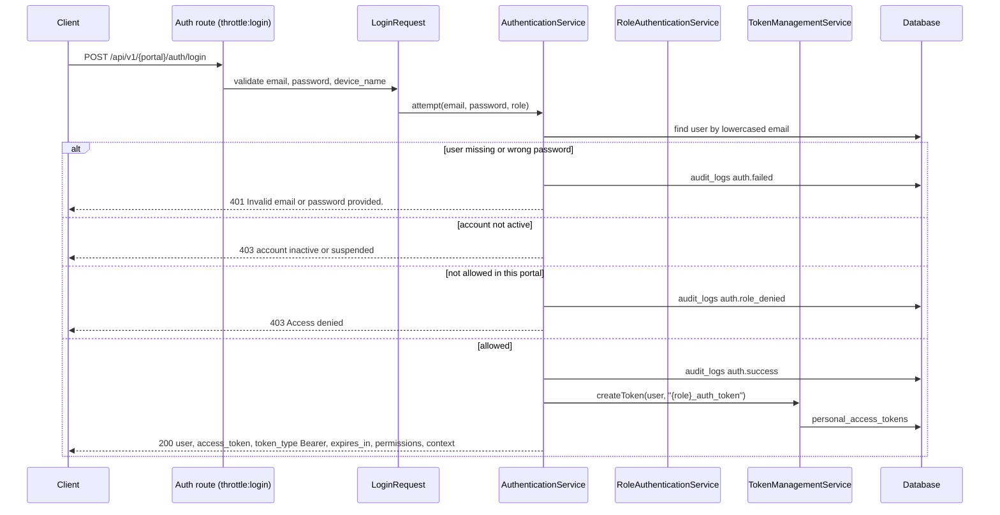

# Authentication workflows

CourtFlex uses **Laravel Sanctum personal access tokens**. Each role has its own authentication routes under `/api/v1/{portal}/auth/*`, but all portals share one `users` table and the same services.

> **Security warning:** Google ID tokens are decoded but their signature is not verified (see [Google sign-in](#google-sign-in)). Until this is fixed, a forged token can sign in as any existing user on the player, owner, staff and organizer portals.

## Portals and what they allow

| Portal | Register | Password login | Google | Who may log in (`RoleAuthenticationService`) |
| --- | --- | --- | --- | --- |
| Players | Yes | Yes | Yes | Any active user. Every active account counts as a player. |
| Owners | Yes (creates a tenant) | Yes | Yes | Users with an active `owner` membership in `tenant_users`. |
| Staff | Through an invitation | Yes | Yes | Users with an active `staff` **or** `owner` membership. |
| Organizers | Through an assignment | Yes | Yes | System admins, `club_manager` members, or active club `manager`/`organizer` members. |
| Admin | No | Yes | Blocked | Users with an active `system_admin` membership. |

## Password login

- The rate limiter `login` allows 5 attempts per minute per email and IP.
- The token response is built by `AuthenticationService::buildAuthResponse()`. For owner and staff logins, `context` holds the first active tenant membership, or the tenant passed as `tenant_id`.
- `expires_in` is `null` because `sanctum.expiration` is not set. Tokens stay valid until revoked.

## Registration

### Player

`POST /players/auth/register` validates with `RegisterRequest` (unique email, password of at least 8 characters with letters and numbers, confirmed), then `AccountProvisioningService::provisionPlayer()` runs in a transaction:

1. Create the `users` row with status `active`.
2. Create a `player_statistics` row with a starting rating of 1200.
3. Return a token response with status 201.

### Facility owner

`POST /owners/auth/register` uses `OwnerRegisterRequest` and `provisionOwner()`. In one transaction it:

1. Creates the user (or reuses an existing one with the same email) and their `player_statistics` row.
2. Creates a `tenants` row from `business_name`. If the slug is taken, a random suffix is added.
3. Creates a `tenant_users` row linking the user to the tenant with the `owner` role.

The response includes a token with the new tenant as `context`.

### Staff (invitation)

`POST /staff/auth/accept-invitation` calls `acceptStaffInvitation()`. It finds a `staff_invitations` row by token that is `pending` and not expired, creates the user if needed, adds the `tenant_users` membership with the invited role, and marks the invitation `accepted`.

**Gap:** no route creates invitations. `AccountProvisioningService::createStaffInvitation()` exists but nothing calls it. Owners can only add existing users directly with `POST /owners/staff`.

### Organizer (assignment)

`POST /organizers/auth/accept-assignment` (authenticated) accepts a `club_invitations` token and makes the user an active `organizer` member of that club.

**Gap:** no route creates club invitations, so tokens can only come from outside the API.

## Google sign-in

`POST /{portal}/auth/google` accepts an `id_token`. `GoogleAuthenticationService::authenticate()`:

1. Rejects the admin role outright.
2. Splits the JWT and base64-decodes the payload. It checks that `sub` and `email` exist, the `exp` time and the issuer.
3. **Does not verify the signature** against Google's public keys. A comment in the code notes this is still to be done.
4. Finds the user by linked provider ID or by email, links the Google identity if needed, and checks the portal with `RoleAuthenticationService`.
5. For unknown emails: players are created, owners are created only when `business_name` is sent, and staff and organizers are refused.

Status: **Partially Implemented**. The flow works, but it is not safe for production until the signature is verified.

**Error handling gap:** a malformed or expired Google token, an unverified Google email, and an invalid or expired invitation token all throw `InvalidArgumentException`. Nothing catches it and `bootstrap/app.php` has no renderer for it, so the client receives a 500 server error instead of a 4xx response.

## Admin login and MFA

`POST /admin/auth/login` uses the same `attempt()` with the `system_admin` role. If `mfa_enabled` is true and no `mfa_code` is sent, it returns 422.

**Gap:** the MFA code is never checked. Any non-empty `mfa_code` passes.

## Logout and token revocation

| Endpoint | Effect |
| --- | --- |
| `POST /{portal}/auth/logout` | Deletes the token used for the request. |
| `POST /{portal}/auth/tokens/revoke-all` | Deletes every token of the user. |
| `POST /{portal}/auth/change-password` | Updates the password hash. Existing tokens stay valid. |
| `POST /{portal}/auth/reset-password` | Sets a new password and deletes all tokens. |

## Password reset

1. `forgot-password` creates a random 64-character token, stores its hash in `password_reset_tokens` and returns `reset_token_sent: true`.
2. `reset-password` checks the token against the stored hash, updates the password, deletes all tokens and removes the reset row.

**Gap:** the plain token is never emailed or returned (the code has a "send via Mail" placeholder), so users cannot complete a reset. Status: **Partially Implemented**.

## Email verification

- `POST /players/auth/verify-email` and `POST /owners/auth/verify-email` have no `auth:sanctum` middleware, so `$request->user()` is always `null` and nothing is verified.
- `POST /players/auth/email/verification-notification` returns a success message but sends nothing.

Status: **Partially Implemented**.

## Related

- [Authorization and tenancy](authorization-and-tenancy.md) explains what happens after a token is accepted.
- The [API reference](/docs-api-endpoints) lists every auth endpoint with its validation rules.
