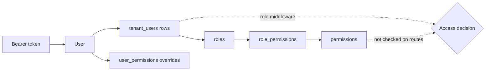

# Authorization and tenant isolation

After `auth:sanctum` accepts a token, access is decided in three places: middleware, controller checks, and query scoping. Laravel policies and the permission matrix exist in the codebase but are **not** part of the request path today.

## Middleware aliases

Registered in `bootstrap/app.php`:

| Alias | Class | What it checks | Failure |
| --- | --- | --- | --- |
| `account.active` | `EnsureAccountActive` | The user's `account_status` is `active`. | 403 |
| `tenant.context` / `tenant.identify` | `IdentifyTenant` | Resolves the tenant from the `X-Tenant-ID` header, a `{tenant}` route parameter or a `tenant_id` input, by ID or slug. Stores it in `TenantContextService`. | 404 unknown tenant, 403 inactive tenant |
| `tenant.access` | `EnsureTenantAccess` | A tenant was resolved and the user has an active membership in it. System admins bypass the membership check. | 400 no tenant, 403 not a member |
| `role` | `EnsureRole` | The user holds one of the listed roles, in the current tenant when one is set. | 403 |
| `permission` / `staff.permission` | `RequirePermission` | A named permission through `PermissionService`. | 403 |

**`RequirePermission` is not applied to any route.** Individual permissions such as `courts.create` are never checked during a request.

## Which portal uses which checks

| Portal | Middleware on business routes |
| --- | --- |
| `public` | `throttle:public-api` |
| `players` | `auth:sanctum`, `account.active`, `role:player`, `throttle:api` |
| `owners` | `auth:sanctum`, `account.active`, `tenant.context`, `tenant.access`, `role:owner`, `throttle:api` |
| `staff` | `auth:sanctum`, `account.active`, `tenant.context`, `tenant.access`, `role:staff`, `throttle:api` |
| `organizers` | `auth:sanctum`, `account.active`, `role:club_manager,owner,system_admin`, `throttle:api` |
| `admin` | `auth:sanctum`, `account.active`, `role:system-admin`, `throttle:api` |

## How roles are evaluated

`User::hasRole()` normalizes the name (`system-admin` becomes `system_admin`) and:

- returns `true` for `player` whenever the account is active, so every active user is a player;
- otherwise looks for an active `tenant_users` row with that role, limited to the current tenant if one is set.

`User::isSystemAdmin()` is `hasRole('system_admin')`, so a system admin is a user with a `system_admin` membership row.

## Inconsistencies between login and route checks

The portal login rules and the route middleware do not always agree:

- **Owners on the staff portal:** `RoleAuthenticationService` lets an owner log into the staff portal, but staff business routes use `role:staff`, which only matches the `staff` role. Owners receive 403 there.
- **Club-only organizers:** a user who is only a club `manager` or `organizer` (no tenant role) can log into the organizer portal, but the organizer business routes require a `club_manager`, `owner` or `system_admin` tenant role. They receive 403.

## Ownership checks in controllers

Most record-level authorization lives in controllers, not policies:

| Controller | Check |
| --- | --- |
| Owners `FacilityController`, `CourtController`, `PaymentController` | The record's `tenant_id` must equal the current tenant, otherwise 403. |
| Staff `BookingController`, `CheckInController`, `PaymentController` | Same tenant check. |
| Players `BookingController` | The booking's `user_id` must be the current user. |
| Players `PaymentController::uploadProof` | The payment's `user_id` must be the current user. |
| Organizers `TournamentController`, `MatchResultController` | The user must be the tournament's `organizer_id`, or a system admin. |
| Organizers `ClubController` | The user must be an active club `manager`/`organizer` (or system admin). Deleting requires being the club creator. |

Cross-tenant records return **403** rather than 404, which confirms to the caller that the record exists.

## Tenant scoping

Tenant-owned models (`Booking`, `Court`, `Facility`, `Payment`, `Tournament`, `Club`, `OpenPlaySession` and others) use `BelongsToTenant`. The trait only adds a `tenant()` relation and a `forTenant()` scope. There is **no global scope**, so each query must filter by `tenant_id` explicitly, as the owner and staff controllers do with `TenantContextService::getTenantId()`.

## Policies

`app/Policies` contains `BookingPolicy`, `ClubPolicy`, `CourtPolicy`, `FacilityPolicy`, `PaymentPolicy`, `TenantPolicy` and `TournamentPolicy`. No controller calls `authorize()`, `Gate` or `can()`, so they have no effect. Status: **Planned** for enforcement.
