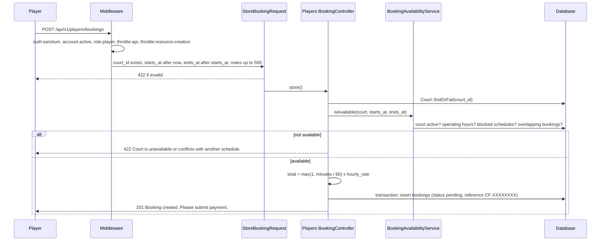
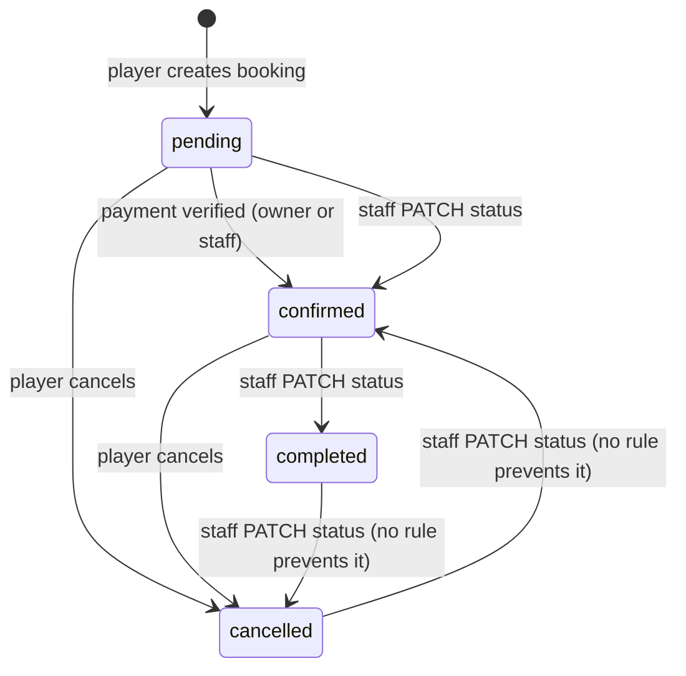

# Booking lifecycle

## Module overview

| | |
| --- | --- |
| Purpose | Let players reserve a court for a time range and let facility staff manage those reservations. |
| Players | `GET/POST /players/bookings`, `GET /players/bookings/{booking}`, `POST /players/bookings/{booking}/cancel` |
| Staff | `GET /staff/bookings`, `GET /staff/bookings/{booking}`, `PATCH /staff/bookings/{booking}/status`, `POST /staff/bookings/{booking}/check-in` |
| Owners | `GET /owners/bookings`, `GET /owners/bookings/{booking}` (read only) |
| Public | `GET /public/courts/{court}/availability` |
| Tables | `bookings`, `booking_participants`, `booking_status_histories` |
| Related | [Payments](payments.md), [Facilities and courts](facilities-and-courts.md) |

## Creating a booking

### Availability rules (`BookingAvailabilityService::isAvailable`)

A slot is available only if all of these hold, checked in order:

1. `ends_at` is after `starts_at`.
2. The court's `is_active` is true.
3. **Operating hours:** if the court has a `court_operating_hours` row for that weekday, it must not be `is_closed`, and the slot must fit between `open_time` and `close_time`. If no row exists for the day, the court is treated as open all day.
4. **Blocked schedules:** no `court_blocked_schedules` row overlaps the slot.
5. **Conflicts:** no booking for the same court with status `pending` or `confirmed` overlaps the slot. Overlap means `starts_at < new end` and `ends_at > new start`.

The same service backs the public availability check, which validates `starts_at` and `ends_at` inline and returns `is_available` with the court's `hourly_rate`.

### Pricing

`total_amount = max(1, duration in minutes / 60) x hourly_rate`, rounded to 2 decimals. Bookings shorter than an hour are charged as one hour.

### Data written

| Column | Value |
| --- | --- |
| `tenant_id` | The court's tenant |
| `user_id` | The current player |
| `booking_reference` | `CF-` and 8 random uppercase characters |
| `status` | `pending` |

No `payments` row is created. See [Payments](payments.md).

## Statuses

The migration documents `pending`, `confirmed`, `completed` and `cancelled`.

- **Player cancel** (`POST .../cancel`) works from any status except `cancelled`, with no time limit, and records a `booking_status_histories` row with the reason "Cancelled by player".
- **Staff status update** accepts `confirmed`, `completed` or `cancelled` with an optional reason. There are **no transition rules**: any status can move to any of those three. A history row is written each time.
- **Payment verification** sets the booking to `confirmed` and writes a history row inside the payment transaction.

## Check-in

`POST /staff/bookings/{booking}/check-in` creates or updates a `booking_participants` row for the booking's player with status `checked_in`. The booking's own `status` is not changed.

## Failure scenarios

| Situation | Response |
| --- | --- |
| No or bad token | 401 |
| Booking belongs to another player | 403 Unauthorized booking access. |
| Booking belongs to another tenant (staff, owner) | 403 |
| Court or booking ID not found | 404 |
| Slot not available | 422 |
| Cancelling a cancelled booking | 400 Booking is already cancelled. |

## Technical notes

- **Race condition:** availability is checked before the transaction, and the transaction only wraps the insert. Two simultaneous requests for the same slot can both pass the check and create overlapping bookings. A row lock or unique constraint would be needed to prevent this.
- **Checked-in or completed bookings** are not counted as conflicts, because only `pending` and `confirmed` are checked.
- `booking_participants` is only written by check-in; there is no endpoint to add guests or participants.
- No events or notifications are dispatched on any status change.
