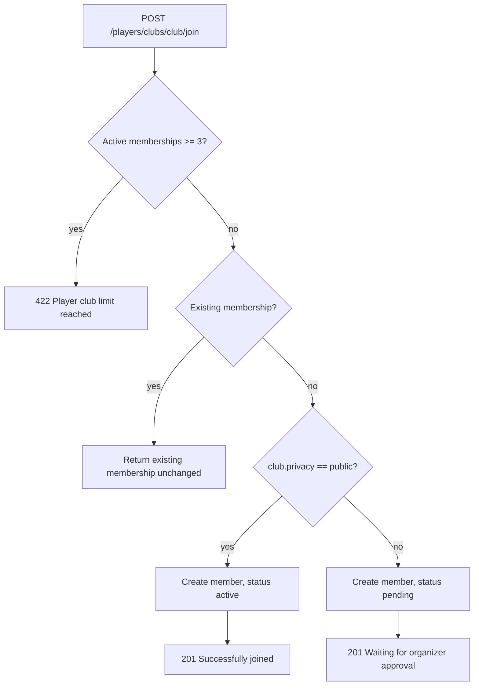

# Clubs

## Module overview

| | |
| --- | --- |
| Organizers | `GET/POST /organizers/clubs`, `GET/PATCH/DELETE /organizers/clubs/{club}`, `GET /organizers/clubs/{club}/members`, `POST /organizers/clubs/{club}/members/{player}/approve` |
| Players | `GET /players/clubs`, `POST /players/clubs/{club}/join` |
| Public | `GET /public/clubs[/{club}]` |
| Tables | `clubs`, `club_members`, `club_invitations` |
| Member roles | `manager`, `organizer`, `member` |

## Create a club (organizer)

1. Organizer routes require a `club_manager`, `owner` or `system_admin` tenant role (see [Authorization and tenancy](authorization-and-tenancy.md)).
2. `StoreClubRequest` validates `name`, optional `description`, `privacy` (`public`, `private` or `invite_only`) and optional `max_members` (5 to 500).
3. A globally unique slug is generated (random suffix on collision).
4. The club is created with the user as `creator_id`, and a `club_members` row makes them the active `manager`.

`tenant_id` is not part of the validated input, so new clubs are not linked to a tenant. The two inserts are not wrapped in a transaction.

## Join a club (player)

- The limit counts every active membership, including clubs the player manages.
- `invite_only` clubs behave like `private`: the request becomes `pending`.
- `max_members` is stored but **not enforced**.

## Approve a member (organizer)

`POST /organizers/clubs/{club}/members/{player}/approve` requires the user to be an active `manager` or `organizer` of that club (or a system admin). It sets the membership to `active`. It returns 404 if the player has no membership, and does not re-check the three-club limit.

## Update and delete

- Update: any active manager or organizer of the club.
- Delete: only the club creator or a system admin. Memberships and invitations cascade.

## Public visibility

- `GET /public/clubs` lists only `privacy = public` clubs.
- `GET /public/clubs/{club}` has **no privacy check**, so private clubs can be read by ID.

## Not implemented

- Creating club invitations: there is no endpoint. Only acceptance exists (`POST /organizers/auth/accept-assignment`).
- Rejecting members, leaving a club, banning, and club activity boards.
