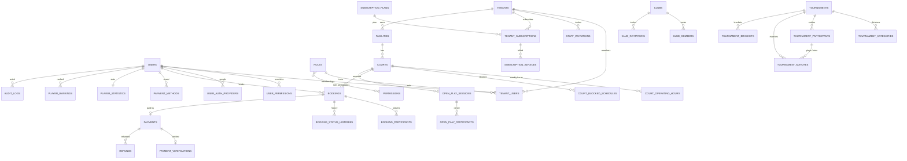

# Database architecture

One shared database holds every tenant's data. Tenant-owned tables carry a `tenant_id` foreign key. Local development and tests use SQLite; the schema is also written for MySQL. All primary keys are auto-incrementing `id` columns, except the `role_permissions` pivot (composite key) and `password_reset_tokens` (keyed by email).

## Relationship diagram

Built from the foreign keys in the migrations.

`tenants.subscription_plan_id` is indexed but has **no foreign key constraint**. `match_results` uses a polymorphic `matchable` relation plus user foreign keys for the participants, winner and verifier.

## Tables by domain

| Domain | Tables | Key constraints |
| --- | --- | --- |
| Identity | `users`, `user_auth_providers`, `password_reset_tokens`, `personal_access_tokens`, `sessions` | `users.email` unique; providers unique on (`provider`, `provider_user_id`) and (`user_id`, `provider`) |
| Tenancy and RBAC | `tenants`, `roles`, `permissions`, `role_permissions`, `tenant_users`, `user_permissions`, `staff_invitations` | `tenants.slug`, `roles.name`, `permissions.name` unique; `tenant_users` unique on (`tenant_id`, `user_id`), so a user has one role per tenant; invitation `token` unique |
| SaaS | `subscription_plans`, `tenant_subscriptions`, `subscription_invoices`, `platform_settings` | plan `slug`, `invoice_number` and setting `key` unique |
| Facilities | `facilities`, `courts`, `court_operating_hours`, `court_blocked_schedules` | facility unique on (`tenant_id`, `slug`); one operating-hours row per court and weekday |
| Bookings | `bookings`, `booking_participants`, `booking_status_histories` | `booking_reference` unique; index on (`court_id`, `starts_at`, `ends_at`) for overlap checks |
| Payments | `payments`, `payment_verifications`, `refunds`, `payment_methods` | `transaction_reference` unique |
| Clubs | `clubs`, `club_members`, `club_invitations` | `clubs.slug` globally unique; one membership per (`club_id`, `user_id`) |
| Open play | `open_play_sessions`, `open_play_participants` | one registration per (session, user) |
| Tournaments | `tournaments`, `tournament_categories`, `tournament_participants`, `tournament_matches`, `tournament_brackets` | tournament unique on (`tenant_id`, `slug`) |
| Rankings | `player_statistics`, `player_rankings`, `match_results` | one statistics row per user |
| Audit | `audit_logs` | indexed by action, entity and (`tenant_id`, `created_at`) |
| Framework | `cache`, `cache_locks`, `jobs`, `job_batches`, `failed_jobs` | Used by the database cache, session and queue drivers |

## Many-to-many relationships

- **Roles and permissions** through `role_permissions` (`Role::permissions()`, `Permission::roles()`).
- **Users and tenants** through `tenant_users`, which also carries `role_id` and `status` (`User::tenants()`, `Tenant::users()`).

## Delete behavior

There are **no soft deletes**. Deletes are permanent and follow these foreign key rules:

| When you delete | Also deleted | Set to null |
| --- | --- | --- |
| A tenant | Its facilities, courts, bookings, payments, open play sessions, tournaments, memberships, invitations and subscriptions | `clubs.tenant_id`, `audit_logs.tenant_id` |
| A facility | Its courts, and through them their bookings, hours, blocks and open play sessions | |
| A court | Its bookings, operating hours, blocked schedules and open play sessions | `tournament_matches.court_id`; `payments.booking_id` of deleted bookings |
| A user | Their bookings, payments, memberships, statistics, rankings, payment verifications they performed, refunds they processed | `booking_participants.user_id`, history `changed_by`, `audit_logs.user_id` |

## Data integrity notes

- Deleting a court through `DELETE /owners/courts/{court}` permanently removes its booking history. The related payments stay but lose their `booking_id`.
- Deleting a user removes financial records they created or verified (`payments`, `payment_verifications`, `refunds`).
- Status columns are plain strings with no database enum or check constraint. Allowed values are only documented in migration comments, and code uses some values that differ from older docs (for example `pending`, not `pending_payment`).
