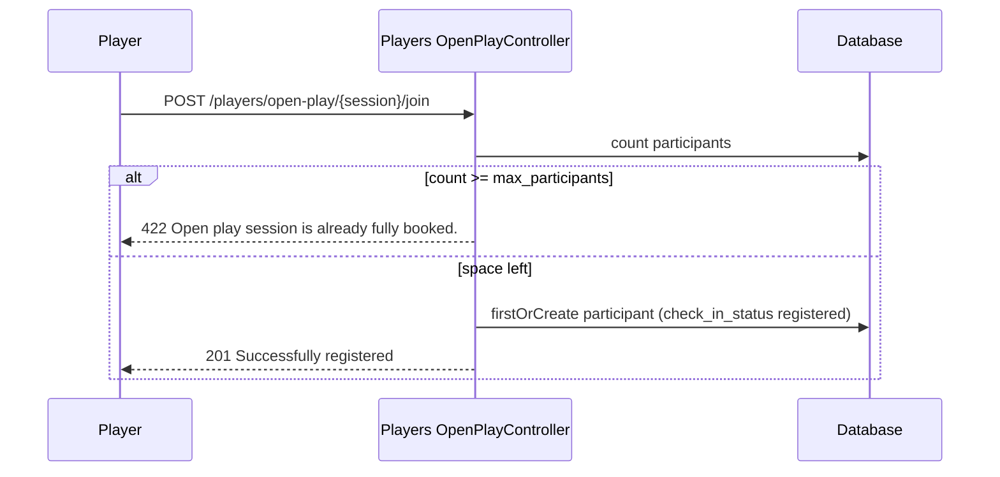

# Open play

Open play sessions are drop-in games on a court with a participant limit, an optional fee and an optional skill range.

## Module overview

| | |
| --- | --- |
| Public | `GET /public/open-play`, `GET /public/open-play/{session}` |
| Players | `GET /players/open-play`, `POST /players/open-play/{session}/join` |
| Tables | `open_play_sessions`, `open_play_participants` |

## Where sessions come from

**No endpoint creates, edits or cancels sessions.** The only code that creates them is `DemoDataSeeder`. Status: **Partially Implemented**.

## Discover sessions

`GET /public/open-play` returns sessions with status `scheduled` or `in_progress` that start now or later, ordered by start time, with their court and facility.

`GET /public/open-play/{session}` returns any session by ID, including its participant rows (user IDs and check-in status).

## Join a session

The unique key on (`open_play_session_id`, `user_id`) prevents duplicate registrations; joining twice returns the existing row.

## Rules that are not checked

| Rule | State |
| --- | --- |
| Session status (joining a cancelled or completed session) | Not checked |
| Session already started or past | Not checked |
| Skill range (`skill_level_min`, `skill_level_max`) | Stored, not checked |
| Fee and payment (`fee`, `payment_id`) | Stored, no payment is created |
| Capacity under concurrent joins | The count and insert are not locked, so simultaneous joins can exceed `max_participants` |

## Not implemented

Session management for owners or staff, waitlists, check-in, cancellations and leaving a session.
