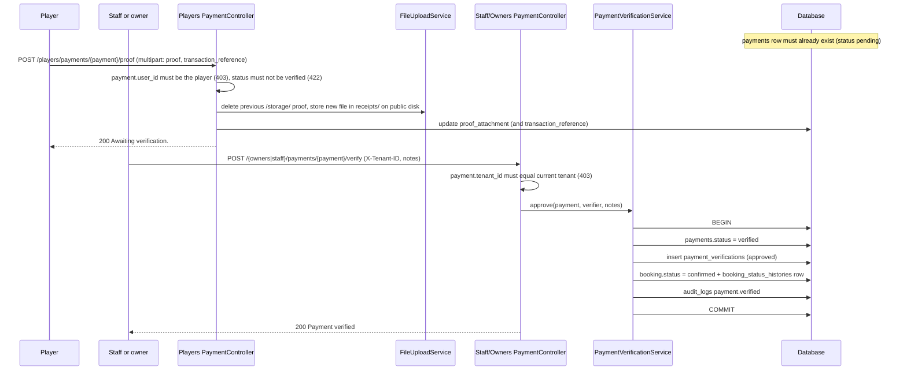

# Payment processing

CourtFlex uses **manual payments**: a player pays outside the platform (for example by bank or e-wallet transfer), uploads a receipt, and facility staff or the owner verify it. There is no payment gateway.

## Module overview

| | |
| --- | --- |
| Players | `GET /players/payment-history`, `POST /players/payments/{payment}/proof` |
| Owners | `GET /owners/payments`, `POST /owners/payments/{payment}/verify` |
| Staff | `GET /staff/payments/pending`, `POST /staff/payments/{payment}/verify` |
| Services | `PaymentVerificationService`, `FileUploadService`, `AuditLogService` |
| Tables | `payments`, `payment_verifications`, `refunds`, `payment_methods` |

## The missing first step

**No code creates `payments` rows.** Booking creation does not create one, and there is no endpoint, service or seeder that does. The proof upload and verification endpoints therefore only work for payment rows inserted outside the API. Status: **Partially Implemented**.

## End-to-end flow (as implemented)

## Business rules

- Proof files: `jpeg`, `jpg`, `png` or `pdf`, up to 5 MB (`UploadPaymentProofRequest`).
- Files are stored with a random 40-character name in `storage/app/public/receipts` and saved as a public `/storage/...` URL. Anyone with the URL can open the receipt.
- A verified payment cannot receive a new proof.
- Verification does not check the payment's current status, so an already verified payment can be verified again (creating another `payment_verifications` row and audit entry).

## Statuses

`payments.status` uses `pending`, `verified`, `failed` and `refunded` (per the migration comment). `PaymentVerificationService::reject()` would set `failed`, but **no route calls it**, so payments cannot be rejected through the API.

## Not implemented

| Capability | State |
| --- | --- |
| Creating payment records | Missing |
| Rejecting a payment | Service method exists, no route |
| Refunds | `refunds` table and `Refund` model exist, nothing writes to them |
| Saved payment methods | `payment_methods` table and model exist, no endpoints |
| Gateways (GCash, Maya, Stripe), webhooks, receipts by email | Planned in `docs/IMPLEMENTATION_ROADMAP.md` |

## Technical notes

- Approval is atomic: the payment, verification record, booking status and history are committed together.
- The audit log entry records the verifier, tenant, old and new status, IP address and user agent.
