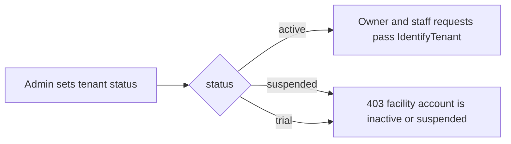

# Platform administration

All admin business routes use `auth:sanctum`, `account.active`, `role:system-admin` and `throttle:api`. These routes are hidden from the public API reference outside the local environment.

## Capabilities

| Endpoint | What it does |
| --- | --- |
| `GET /admin/dashboard` | Counts tenants, active tenants, users and bookings; sums verified payment amounts; shows the 5 latest audit logs. |
| `GET /admin/tenants` | Paginated tenants, filterable by `status` and a name `search`. |
| `POST /admin/tenants` | Creates a tenant (slug generated, default status `active`). No owner membership is created. |
| `GET /admin/tenants/{tenant}` | Tenant with facilities and subscription. |
| `PATCH /admin/tenants/{tenant}/status` | Sets `active`, `suspended` or `trial`. |
| `GET /admin/subscriptions` | All plans with subscription counts, plus the 20 most recent tenant subscriptions. |
| `POST /admin/subscription-plans` | Creates a plan with a generated slug. |
| `GET /admin/analytics` | User growth per day. |
| `GET /admin/audit-logs` | Paginated audit logs with the acting user. |
| `GET /admin/settings` | All rows of `platform_settings`. |

## Tenant status and facility access

`Tenant::isActive()` is true only for `active`. **A tenant on `trial` is treated as suspended**, so its owners and staff are locked out of their business routes. Public discovery endpoints do not check tenant status.

## Not implemented

- Subscription billing: `tenant_subscriptions` and `subscription_invoices` are read but never created or charged.
- Plan limits (`max_courts`, `max_staff`) are not enforced.
- Editing platform settings (read only).
- Audit logging of admin actions: changing a tenant's status or creating plans is not audit-logged.
