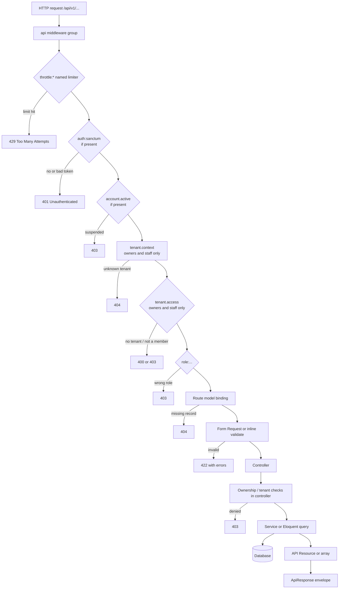

# System architecture

CourtFlex is a stateless JSON API. Every business request enters through `routes/api.php`, which mounts six route files under `/api/v1`. There are no Blade screens for the product itself; the only web routes are the two documentation portals.

## Request lifecycle

This is the path a request actually takes. Steps marked "if present" depend on the portal.



The middleware order above matches the order in the route files. For example, the facility owner business routes use `['auth:sanctum', 'account.active', 'tenant.context', 'tenant.access', 'role:owner', 'throttle:api']`.

## Layers

| Layer | Where | What it does |
| --- | --- | --- |
| Routing | `routes/api.php`, `routes/api/v1/` | Splits the API into role portals with their own middleware stacks. |
| Middleware | `app/Http/Middleware/` | Account status, tenant resolution, tenant membership and role checks. Aliases are registered in `bootstrap/app.php`. |
| Validation | `app/Http/Requests/` | Form Requests for most writes; a few endpoints validate inline with `$request->validate()`. |
| Controllers | `app/Http/Controllers/Api/V1/` | One namespace per portal. Controllers also perform ownership checks (for example, a booking must belong to the player). |
| Services | `app/Services/` | Authentication, provisioning, availability, payment verification, audit logging, uploads and tenant context. |
| Models | `app/Models/` | 37 Eloquent models. Tenant-owned models use the `BelongsToTenant` trait. |
| Resources | `app/Http/Resources/` | 13 API Resources shape JSON output. Some endpoints return models or arrays directly. |
| Responses | `app/Http/Traits/ApiResponse.php` | `successResponse()` and `errorResponse()` build the shared envelope. |

## Response envelope

Every controller uses the `ApiResponse` trait:

```json
{ "success": true, "message": "...", "data": {}, "meta": {} }
{ "success": false, "message": "...", "errors": {} }
```

Framework exceptions are converted to the same error shape in `bootstrap/app.php` for any `api/*` request: validation (422), authentication (401), authorization and access denied (403), missing models or routes (404) and rate limits (429).

## Services and who calls them

| Service | Called from |
| --- | --- |
| `AuthenticationService` | All five `*AuthController` classes for login and token responses. |
| `AccountProvisioningService` | Player and owner registration, Google sign-up, staff invitation and organizer assignment acceptance. |
| `GoogleAuthenticationService` | The `google` endpoints of every portal except admin. |
| `RoleAuthenticationService` | `AuthenticationService` and `GoogleAuthenticationService`, to decide which portal a user may log into. |
| `TokenManagementService` | Login responses, logout and revoke-all. |
| `PasswordResetService` | Forgot and reset password endpoints. |
| `TenantContextService` | `IdentifyTenant` sets it; owner, staff and organizer controllers read it. Registered as a singleton in `AppServiceProvider`. |
| `PermissionService` | `EnsureTenantAccess` (membership) and `RequirePermission` (not used by any route). |
| `BookingAvailabilityService` | Player booking creation and the public availability check. |
| `PaymentVerificationService` | Owner and staff payment verification (`approve()` only). |
| `AuditLogService` | Login attempts and payment verification only. |
| `FileUploadService` | Avatar and payment proof uploads. |

## What the backend does not have

These building blocks are absent, even though some planning documents mention them:

- No events, listeners, jobs or notifications (`app/Events`, `app/Jobs`, `app/Notifications` do not exist). See [Background jobs and notifications](background-processing.md).
- No mail is sent anywhere. Password reset and email verification do not deliver messages.
- The 7 policies in `app/Policies` are never invoked. Authorization happens in middleware and controllers. See [Authorization and tenancy](authorization-and-tenancy.md).
- No external payment gateway or Google signature verification. See [Payments](payments.md) and [Authentication](authentication.md).
