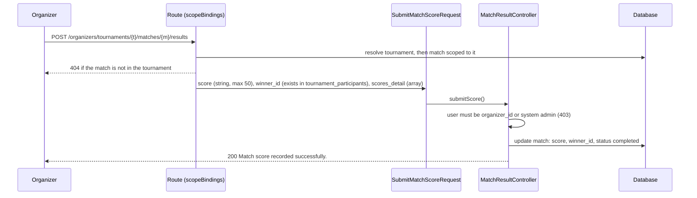

# Tournaments and match scoring

## Module overview

| | |
| --- | --- |
| Organizers | CRUD on `/organizers/tournaments`, `POST /organizers/tournaments/{tournament}/matches/{match}/results` |
| Players | `GET /players/tournaments`, `POST /players/tournaments/{tournament}/register` |
| Public | `GET /public/tournaments[/{tournament}]` |
| Tables | `tournaments`, `tournament_categories`, `tournament_participants`, `tournament_matches`, `tournament_brackets` |

## Create a tournament (organizer)

1. `StoreTournamentRequest` validates `name`, `format` (`single_elimination`, `double_elimination` or `round_robin`), dates (`ends_at` after `starts_at`, `registration_deadline` before `starts_at`), `entry_fee`, `max_teams` (4 to 128) and an optional `tenant_id` that must exist.
2. The tenant is chosen in this order: the tenant context (never set on organizer routes, which have no `tenant.context` middleware), then the `tenant_id` input, then **the first tenant in the database**.
3. A slug unique within the tenant is generated, and the tournament is created with status `upcoming` and the user as `organizer_id`.

**Integrity note:** the organizer's membership in the chosen tenant is not checked, so an organizer can create a tournament under any tenant. Without `tenant_id`, it silently lands in the first tenant.

Show, update and delete require the user to be the tournament's `organizer_id` or a system admin.

## Register (player)

`POST /players/tournaments/{tournament}/register` validates an optional `tournament_category_id`, `partner_id` and `team_name`, then `firstOrCreate`s a `tournament_participants` row with status `registered`.

Not checked:

- tournament status or `registration_deadline`;
- `max_teams` capacity;
- that the category belongs to this tournament;
- `entry_fee` (no payment is created).

## Record a match score (organizer)

What scoring does **not** do:

- check that `winner_id` is one of the two participants in this match (any participant ID in the table passes validation);
- save `scores_detail`;
- create a `match_results` row;
- update `player_statistics`, `player_rankings` or brackets;
- advance a winner to the next round.

## Not implemented

Bracket generation, seeding, match scheduling, categories management, live scoring and rating calculation are listed in the roadmap but have no code. No controller, service or seeder creates matches or categories, so the score endpoint can only act on rows inserted directly into the database.
